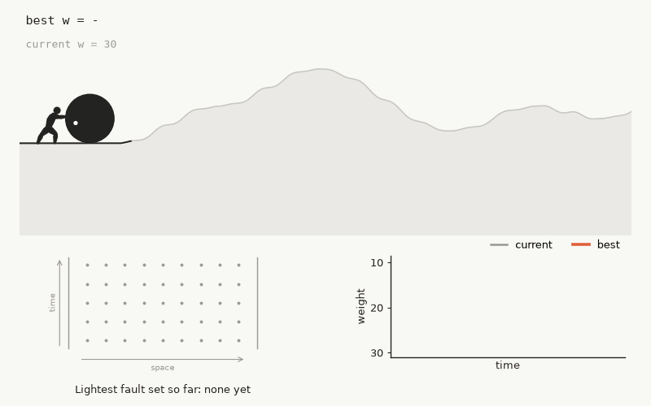

# Sisyphus: a fast circuit-level distance estimator

Sisyphus estimates the circuit-level distance of quantum error-correction circuits and the
distance of CSS codes. Given a noisy syndrome-extraction circuit as a detector error model
(DEM), it finds small sets of faults that flip a logical observable without triggering any
detector; given a CSS code, it finds low-weight logical operators. The lightest solution
found is an upper bound on the distance, and every bound comes with a witness that can be
checked independently.

<p align="center">
  
</p>

Sisyphus is a hill-climbing variant of information-set decoding (ISD). It builds on Prange's
algorithm and its standard refinements, on the quantum distance tools QDistRnd, dist-m4ri and
QDistEvol, and on classical metaheuristics
[[1](#ref-1)–[7](#ref-7), [11](#ref-11)–[14](#ref-14)]. As in other ISD methods, light
codewords are read off a systematic generator matrix, as single rows or as sums of a few rows
found by a collision search, and the search moves between neighbouring information sets by
column swaps. Sisyphus learns where to move: per-column scores, raised by every light
codeword found, decide which columns leave and enter the information set. Searches that stop
improving forget part of what they learned and restart, and many independent searches run in
parallel. The code is Python with [Numba](https://numba.pydata.org/)-compiled, bit-packed
GF(2) kernels.

Sisyphus builds on three existing tools: [QDistRnd](https://github.com/QEC-pages/QDistRnd),
the GAP package that made randomized information-set search practical for quantum codes;
[dist-m4ri](https://github.com/QEC-pages/dist-m4ri), its C successor for codes and
circuit-level models, whose benchmark circuits and DEM reduction we use; and
[QDistEvol](https://github.com/m-webster/codeDistancePYPI), which evolves a population of
information sets instead of drawing them independently. If you use Sisyphus in published
work, please cite it together with QDistRnd and the distance-finding paper of Webster, Jacob
and Higgott (see [Citing](#citing)).

Results, from the [benchmarks](#benchmarks) against dist-m4ri, QDistEvol and sqetch on the
same problems and hardware:

- On the larger memory-experiment circuits, Sisyphus is the only one of the four tools that
  reaches the target weight within the time limit. It improves several published
  circuit-level bounds, including a weight-31 fault set in the 34-round memory circuit of the
  [[756,16,34]] bivariate bicycle code.
- On a one-round circuit of a [[4608,2308,20]] code it reaches weight 22 within an hour and
  20 in longer runs; the other tools stay above 170.
- It reaches the distance of every code tested, up to [[4608,2308,20]].

## Contents

1. [Installation](#installation)
2. [Quick start](#quick-start)
3. [Problem](#problem)
4. [Method](#method)
5. [API](#api)
6. [Options](#options)
7. [Benchmarks](#benchmarks)
8. [Limitations](#limitations)
9. [Repository layout](#repository-layout)
10. [Citing](#citing)
11. [References](#references)
12. [Acknowledgements](#acknowledgements)
13. [Disclosure](#disclosure)
14. [License](#license)

## Installation

```bash
git clone https://github.com/varunmenon1310/sisyphus.git
cd sisyphus
pip install -e .            # numpy, numba, scipy
pip install -e ".[circuits]"  # adds stim, for circuit-level instances
```

Python ≥ 3.10. The first call compiles the kernels with Numba (about 30 s); the compiled code
is cached next to the package.

## Quick start

### Distance of a CSS code

```python
from sisyphus_qec import css_distance

# Hx, Hz: binary parity-check matrices (numpy arrays, Hx @ Hz.T = 0 mod 2)
res = css_distance(Hx, Hz, num_trials=200_000, num_workers=8)

res.distance          # min over both sides: an upper bound on the code distance
res.x.distance        # X side (X-type logicals)
res.z.witness         # one Z logical of weight res.z.distance (0/1 vector)
res.z.codewords       # all distinct minimum-weight Z logicals found, one per row
```

Stop at the first logical of a known or target weight with `cutoff`:

```python
res = css_distance(Hx, Hz, num_trials=10_000_000, num_workers=16, cutoff=12)
```

### Circuit-level distance from a Stim circuit

```python
import stim
from sisyphus_qec import dem_to_matrices, side_distance, lift_columns, verify_fault_set

circuit = stim.Circuit.from_file("memory_experiment.stim")
dem = circuit.detector_error_model(decompose_errors=False)
H, L, columns = dem_to_matrices(dem)          # detectors x faults, observables x faults

res = side_distance(H, None, pair_rows=L, num_trials=10_000_000,
                    num_workers=16, time_limit=600)
faults = lift_columns(res.witness, columns)   # indices of errors in dem.flattened()
assert verify_fault_set(dem, faults)          # independent check on the DEM
print("circuit distance <=", res.distance)
```

Complete scripts are in [`examples/`](examples/): `code_distance.py` (gross code,
distance 12) and `circuit_distance.py` (surface-code memory circuit, distance 5).

## Problem

**Code distance.** For a CSS code with check matrices `Hx` and `Hz`, an X-type logical
operator is a binary vector `c` with `Hz c = 0` that is not a sum of rows of `Hx`. The X
distance is the minimum weight of such a vector; the Z distance swaps `Hx` and `Hz`; the code
distance is the smaller of the two.

**Circuit-level distance.** A detector error model [[8](#ref-8)] lists the faults of a noisy
circuit and the detectors and logical observables each fault flips. With one column per fault,
let `H` be the detector matrix and `L` the observable matrix. The circuit-level distance is
the minimum weight of `c` with `H c = 0` and `L c ≠ 0`: the fewest faults that flip an
observable without flipping a detector. It is usually below the code distance, because single
faults such as hook errors on ancilla qubits spread to several data qubits.

Both are instances of one problem: the minimum weight of a vector in the kernel of a binary
matrix outside a given subspace. The problem is NP-hard, and Sisyphus does not prove that no
lighter vector exists.

## Method

### Information-set decoding

Let `G` be a `k × n` generator matrix of the space searched (for X logicals, a basis of
`ker Hz`). Gaussian elimination on a chosen set of `k` columns, the information set, brings
`G` to systematic form: those columns become an identity matrix, and each row has a single 1
inside the information set. A codeword with at most one nonzero entry inside the information
set is then one of the rows [[1](#ref-1)]. Checking sums of two or three rows also finds
codewords with two or three entries inside [[2](#ref-2)]. Sorting rows by their values on `ℓ`
random redundant columns and combining only rows in the same bucket makes this search
efficient [[3](#ref-3)]. Instead of a full elimination per trial, one can move to a
neighbouring information set by swapping one column in and one out, which costs one row
operation per affected row [[4](#ref-4)]; the search becomes a random walk over information
sets.

### What Sisyphus adds

One step of a random walk in Sisyphus:

1. swap 8 columns between the information set and the redundant columns, chosen by learned
   column scores;
2. look for light codewords among single rows and among sums of two or three rows (collision
   search on `ℓ = 12` columns);
3. reduce each codeword found greedily, by adding rows of the basis while its weight drops;
4. verify that it is a nontrivial solution;
5. update the column scores.

Every 150–2,000 steps, depending on the size of the code, the walk starts again from a fresh
information set, also chosen by the scores. The heuristics involved:

| heuristic | role |
|---|---|
| learned column scores | choose the leaving column (highest score among 8 drawn at random: tournament selection [[14](#ref-14)]) and the entering column (lowest score); with probability ε = 0.08–0.25 a move is uniform instead |
| iterated local search [[12](#ref-12)] | a walk that stops improving resets part of its scores and restarts |
| a non-learning walk | one of every four walks moves uniformly at random |
| greedy weight reduction | local search on every codeword found |
| independent parallel searches [[13](#ref-13)] | each worker runs four walks and is replaced by a freshly seeded one after 250,000 steps |
| detector time windows | for circuits, half of the searches work on a range of consecutive detectors |

**Learning the information sets.** Each walk keeps a score `θ_c ≥ 0` for every column `c`,
initially zero. After every step, all scores decay, `θ_c ← (1 − δ) θ_c`, and every nontrivial
row of weight `w ≤ w* + m`, where `w*` is the walk's best weight so far, adds
`η (w* + m − w + 1)` to the scores of the columns in its support. The entering column is
chosen among the redundant columns where the leaving column's row has a 1, and a restart
eliminates the columns in order of score plus random noise. Columns of
light codewords are thus kept out of the information set, where the read-off finds them, and
each light codeword makes nearby lighter ones easier to find. The three learning walks of a
search use `(η, δ, m, ε)` = `(1.0, 0.010, 3, 0.10)`, `(1.5, 0.006, 2, 0.08)` and
`(1.0, 0.010, 3, 0.25)`; the fourth walk does not learn (`ε = 1`).

**Escaping local optima.** Left alone, the scores concentrate on the columns of the best
codeword so far and the walk keeps finding it again. When a walk's best weight has not
improved for 1,000 steps and for twice its longest earlier gap between improvements, it resets
the scores of a random 30% of its best codeword's columns and restarts.

**Parallel searches.** A search is a group of four walks in one worker process. Searches do
not exchange information. Each runs for at most 250,000 steps and is then replaced by a
freshly seeded one until the budget `num_trials` is spent; on hard instances the outcome
varies more between searches than within one, so many moderate searches do better than a few
long ones. All searches stop as soon as one reaches `cutoff`.

**Detector time windows.** The light fault sets of a memory experiment usually span a few
rounds. On circuit-level models, half of the searches work on a window of consecutive
detectors and keep only the faults whose detectors all lie in it; a solution of the window
problem, padded with zeros, solves the full problem. Windows come in five sizes, from half to
1/32 of the detectors, with 50% overlap, and each window search moves to a new random window
periodically. Window problems are 10–50× smaller than the full model. Windows are used when
the matrix has at least 6× more columns than rows, which holds for circuit-level models and
not for codes.

**Linear algebra.** Matrices are stored as 64-bit words, and elimination and batched column
swaps use the Method of Four Russians [[9](#ref-9), [10](#ref-10)]. Only the redundant part
`P` of the systematic form `[I | P]` is stored, so work and memory scale with `n − k` rather
than `n`: 4× less on rate-1/2 codes and about 10× less on circuit-level models. A fresh
information set is computed by eliminating the check matrix in the chosen column order, which
gives `[I | P]` without a kernel basis and is 16–35× cheaper on circuit-level models than
reducing a stored generator matrix.

**Verification.** A vector in the kernel may still be trivial (a stabilizer). Each row carries
its parities against 64 random vectors that detect nontriviality (random elements of the
kernel of the opposite check matrix for codes; random combinations of observable rows for
circuits). A nonzero parity proves that the vector is nontrivial, so Sisyphus never reports a
stabilizer; a nontrivial vector is missed with probability 2⁻⁶⁴.

## API

```python
from sisyphus_qec import css_distance, side_distance
from sisyphus_qec import dem_to_matrices, lift_columns, verify_fault_set
```

### `css_distance(Hx, Hz, num_trials=20000, num_workers=1, seed=None, cutoff=0, basis="both", ...)`

Distance of the CSS code with X checks `Hx` and Z checks `Hz`. Searches Z
logicals (kernel of `Hx` outside the row space of `Hz`) first, then X logicals.
`basis="z"` or `"x"` searches one side only. With `cutoff > 0` the X side is
skipped when the Z side already reached the cutoff. `num_trials` applies per
side. Returns a `CssDistanceResult` with fields `x` and `z` (each a
`SideResult`) and `distance` (the minimum over the sides searched).

### `side_distance(check_H, dual_H, num_trials=20000, num_workers=1, seed=None, cutoff=0, pair_rows=None, ...)`

Lightest vector `c` with `check_H c = 0` outside the row space of `dual_H`. For
X logicals of a CSS code call `side_distance(Hz, Hx)`, for Z logicals
`side_distance(Hx, Hz)`. For a detector error model call
`side_distance(H, None, pair_rows=L)`: `pair_rows` is any set of vectors such
that `c` is nontrivial exactly when it has odd overlap with one of them (for a
DEM, the observable matrix).

### `SideResult`

| field | meaning |
|---|---|
| `distance` | weight of the lightest verified solution found (an upper bound); `-1` if the side was skipped |
| `witness` | one solution of that weight (uint8 vector) |
| `codewords` | all distinct solutions of that weight found (one per row; capped by `max_codewords` per search) |
| `counts` | how many times each of them was found |
| `num_codewords` | number of rows of `codewords` |
| `shots` | steps performed (all walks) |
| `wall_time` | seconds |
| `islands` | number of independent searches run |
| `t_best` | estimated time (s) at which `distance` was first reached |

### DEM helpers (`sisyphus_qec.dem`)

- `dem_to_matrices(dem, merge_duplicates=True)` → `(H, L, columns)`. One
  column per fault of a `stim.DetectorErrorModel`. Faults with identical effects
  are merged; `columns[j]` lists the DEM error indices behind column `j`.
- `lift_columns(codeword, columns)` maps a solution over the columns to DEM
  error indices (positions among the error instructions of `dem.flattened()`).
- `verify_fault_set(dem, error_indices)` is an independent check on the DEM:
  the faults are distinct, flip no detector, and flip at least one observable.

Matrices are passed as dense 0/1 numpy arrays and bit-packed internally.

## Options

The defaults were chosen by equal-wall-clock comparisons on codes and circuit-level models of
all sizes in the benchmarks, and we recommend keeping them. To tune them for a family of
instances, use an automated search scored by time to target over several seeds rather than
manual changes.

Run options are the ones normally set. Search parameters can also be passed as keyword
arguments to `css_distance` and `side_distance`.

### Run options

| option | default | meaning |
|---|---|---|
| `num_trials` | `20000` | total number of steps over all searches (per side for `css_distance`). One step = one move of one walk plus the search for light codewords. |
| `num_workers` | `1` | searches run in parallel (one process each). `None` = all available CPU cores. `1` runs in the calling process. |
| `cutoff` | `0` | stop as soon as a solution of weight `≤ cutoff` is found. `0` runs the whole budget, which also collects the set of minimum-weight solutions. |
| `time_limit` | `None` | wall-clock budget in seconds (`side_distance`). The search returns the best result so far when it expires. Needs `num_workers ≥ 2`. |
| `seed` | `None` | random seed (`None` = fresh randomness). |
| `island_shots` | `None` | step budget of one search before it is replaced by a fresh one. `None` = an equal share of `num_trials` per worker, capped at 250,000. |
| `walkers_per_island` | `4` | random walks per search: three learning walks with different settings and one non-learning walk. Larger values reuse these settings in turn. |
| `num_seeds` | `None` | older alternative to `island_shots`: split the budget into this many waves of `num_workers` searches. |
| `pair_rows` | `None` | vectors defining nontriviality (see `side_distance`). Required for detector error models (`L`). |
| `collect_codewords` | `True` | keep the set of minimum-weight solutions (otherwise one). |
| `basis` | `"both"` | `css_distance` only: `"both"`, `"z"` or `"x"`. |
| `compact` | `None` | `None` / `True`: compact `[I | P]` storage. `False`: full-width rows (same search, slower). |

### Search parameters

| parameter | default | meaning |
|---|---|---|
| `swaps_per_shot` | `8` | column swaps per step, applied as one batch. |
| `restart_interval` | `None` | steps between fresh information sets. `None` = `min(2000, max(150, k/3))` with `k` the dimension of the searched space. |
| `lb_p` | `2` | sums of rows examined: `0` single rows only, `1` + pairs, `2` + triples. |
| `lb_hash_l` | `12` | `ℓ`, the number of random redundant columns used to bucket rows in the collision search [[3](#ref-3)]. `0` = exhaustive pairs and triples among the lightest rows instead. |
| `lb_M` | `256` | size of the list of lightest rows used for triples. Use `48` with `lb_hash_l=0`. |
| `lb_R` | `48` | rows used as the first element of a triple. |
| `lb_hash_windows` | `1` | independent random column sets for bucketing per step. |
| `greedy_passes` | `4` | sweeps of greedy weight reduction per codeword found (`0` = off). |
| `kick_rounds` | `1000` | a learning walk whose best weight has not improved for this many steps partially forgets and starts over (`0` = off). |
| `kick_frac` | `0.3` | fraction of the best codeword's columns whose score is reset when starting over. |
| `kick_patience` | `2.0` | also wait at least this multiple of the walk's longest gap between improvements so far. |
| `restart_from_h` | `1` | compute fresh information sets by eliminating the check matrix (cheaper; identical result). |
| `windows` | `"auto"` | detector time windows: `"auto"` = 5 levels when columns ≥ 6× rows (circuit models), otherwise off. An integer sets the number of levels; `0` = off. |
| `window_frac` | `0.5` | fraction of searches that run on a window. |
| `window_rounds` | `5000` | steps a window search spends on one window before moving to another. |
| `window_min` | `16` | smallest window, in detectors. |
| `explorer_restart` | `0` | how often the non-learning walk starts over (`0` = same as the others). `1` draws a fresh uniform information set every step. |
| `max_codewords` | `2000` | minimum-weight solutions stored per search. |
| `m4ri_k` | `8` | block size of the Method of Four Russians [[9](#ref-9)] in elimination. |
| `proj_words` | `1` | 64-bit words of random parities used for verification (64 parities per word). |
| `migrate_interval`, `migrate_boost` | `100`, `0.0` | sharing of the best codeword between the walks of a search (off by default: it made the walks converge on one codeword). |
| `stall_rounds` | `0` | restart a whole search after this many steps without improvement (off). |
| `greedy_kicks`, `kick_size`, `mix_rate`, `lb_hash_p4` | `0`, `2`, `0.0`, `0` | experimental; not used by the default compact search. |

## Benchmarks

Sisyphus, [dist-m4ri](https://github.com/QEC-pages/dist-m4ri) [[6](#ref-6)],
QDistEvol [[7](#ref-7)] and [sqetch](https://github.com/a7b/yarn/tree/main/sqetch) were run on
the same 13 problems:

- The CPU tools each get 16 cores of one Intel Xeon 8480 node: 16 worker processes for
  Sisyphus, 16 threads for dist-m4ri (v0.14.7, random information sets, default settings), and
  16 independent runs for QDistEvol (`codedistance` v0.0.8, default settings), timed to the
  first run that reaches the target. sqetch runs only on GPUs and gets one NVIDIA A100 (sketch
  dimension 64, or the largest that fits).
- Each run stops at the target weight, which is the exact distance where known and otherwise
  the lightest known weight. Each tool has three runs per problem.
- A time range gives the fastest and slowest run that reached the target, with "(k of 3)" if
  only k did. "best w" is the lightest weight found when no run reached the target. Times
  exclude loading and compilation. All solutions were verified.

Circuits are memory experiments from the dist-m4ri benchmark set (SI1000 noise) or single
noisy rounds of syndrome extraction; sizes are detectors × faults after exact reduction to one
basis.

| problem | target | limit | Sisyphus | dist-m4ri | QDistEvol | sqetch |
|---|---|---|---|---|---|---|
| gross [[144,12,12]] | 12 | 10 min | 0.03–0.04 s | < 0.01 s | < 0.01 s | 0.01 s |
| [[756,16,34]] bivariate bicycle [[15](#ref-15)] | 34 | 10 min | 0.07–0.2 s | 0.1–0.5 s | 2.4–5.8 s | 80 s (1 of 3) |
| [[1152,580,12]] affine-permutation | 12 | 10 min | 0.04–0.09 s | 0.01 s | 0.4–3.2 s | 0.09–0.2 s |
| [[2304,1156,14]] affine-permutation | 14 | 10 min | 0.1–0.2 s | 0.04–0.1 s | 18–26 s (2 of 3) | 2.6–83 s |
| [[2844,1426,18]] Cornucopia [[16](#ref-16)] | 18 | 10 min | **2–3 s** | 14–40 s | best 24 | best 22 |
| [[4608,2308,20]] affine-permutation, X | 20 | 1 h | 108–359 s | 86–1,700 s | best 212 | best 22 |
| [[4608,2308,20]] affine-permutation, Z | 20 | 1 h | 813–2,043 s | **125–664 s** | best 192 | best 128 |
| gross circuit, 12 rounds (936 × 8,784) | 10 | 10 min | 0.4–0.5 s | 0.03–0.06 s | 89–357 s | best 11 |
| Mitten [[270,54,10]] circuit (648 × 8,910) | 9 | 10 min | 0.2–0.3 s | 0.04–0.4 s | 487 s (1 of 3) | best 10 |
| double gross [[288,12,18]] circuit, 18 rounds (2,736 × 26,208) | 16 | 30 min | **3–6 s** | best 18 | best 31 | best 23 |
| [[360,12,24]] circuit, 24 rounds (4,500 × 43,560) | 21 | 30 min | **9–10 s** | best 22 | best 63 | best 39¹ |
| [[756,16,34]] circuit, 34 rounds (13,230 × 129,276) | lightest | 1 h | **31** (329–409 s) | 45 | out of memory² | does not fit³ |
| [[4608,2308,20]] circuit, one round (2,304 × 29,952) | 20 | 1 h | **22** | 490 | 574 | 174 |

¹ sqetch's own codeword recovery did not return a valid word of this weight.
² Sixteen parallel runs on this problem need more than the 180 GB of the allocation.
³ One sketch row plus the column permutation exceed the GPU's shared memory per block.

In longer runs (8 hours, 48 cores, 4 runs each) on the one-round circuits, Sisyphus reaches
weight 20 on the [[4608,2308,20]] circuit in 4 of 8 runs, where dist-m4ri stays above 470, and
on a [[2232,1120,16]] two-block group-algebra code it reaches 13 (Z basis) and 14 (X basis) in
every run, matching dist-m4ri's best (13 in every run; 14 in 2 of 4).

Summary:

- On small problems (codes up to a few thousand qubits, circuits up to about 10⁴ faults),
  Sisyphus and dist-m4ri reach the target in under a second, dist-m4ri usually first because of
  its lower start-up cost. QDistEvol and sqetch are as fast on the smallest codes but take
  minutes or stop above the target on the small circuits.
- On larger circuits Sisyphus is ahead: it is the only tool that reaches the target on the
  double-gross and [[360,12,24]] circuits, and it finds the lightest fault sets on the two
  largest circuits.
- On large codes the results are mixed. Sisyphus is fastest on [[2844,1426,18]], it overlaps
  with dist-m4ri on the X side of [[4608,2308,20]], and dist-m4ri is faster on the Z side.
- QDistEvol and sqetch reach the distance of codes up to [[2304,1156,14]], not in every run,
  and not of the larger codes or circuits. sqetch searches a fixed sketch of one basis and
  levels off above the distance (22 on [[2844,1426,18]], 128 on the Z side of
  [[4608,2308,20]]).

### Bounds tighter than the best published

Found by Sisyphus. Each witness in [`benchmarks/witnesses/`](benchmarks/witnesses/) lists its
faults (the detectors and observables each one flips) and can be checked against the original
circuits with Stim:

```bash
python benchmarks/verify_witnesses.py /path/to/dist-m4ri/benchmark
```

| circuit (dist-m4ri benchmark) | published | **Sisyphus** |
|---|---|---|
| `bb_756_16_34_si1000_r34`, X basis | not computed (code distance 34) | **31** |
| `bb_360_12_24_si1000_r24`, X and Z basis | ≤ 23 (X) | **21** |
| `double_gross_288_12_18_si1000_r18`, X and Z basis | ≤ 18 (X) | **16** |
| `double_gross_288_12_18_uniform_r18`, X basis | not computed | **16** |
| `gross_144_12_12_uniform_r12`, X basis | ≤ 11 | **10** |

The weight-31 fault set of the [[756,16,34]] circuit is below the code distance; the
syndrome-extraction schedule loses distance to hook errors.

## Limitations

- Sisyphus gives upper bounds only. For lower bounds use an exact method, for example the
  connected-cluster search of dist-m4ri.
- Matrices are passed as dense arrays (one byte per entry before packing), which matters above
  about 10⁵ × 10⁵. A reduced circuit model of 13,230 × 129,276 takes about 1.7 GB.
- `time_limit` needs `num_workers ≥ 2`; a single in-process search runs until its budget is
  spent.
- The first call compiles the kernels (about 30 s); later runs use the cache.

## Repository layout

```
sisyphus/
├── sisyphus_qec/
│   ├── search.py         public entry points (css_distance, side_distance) and the
│   │                     parallel searches (process pool, scheduling, early stop)
│   ├── setup.py          per-side setup: packed check matrix, verification parities,
│   │                     starting basis
│   ├── chain_compact.py  one search (four random walks) on the compact [I | P] form (default)
│   ├── chain_full.py     the same on full-width rows (compact=False)
│   ├── extraction.py     light codewords from rows and sums of rows (collision search)
│   │                     and greedy weight reduction
│   ├── windows.py        detector time windows for circuit-level models
│   ├── gf2.py            bit-packed GF(2) linear algebra (Four-Russians row reduction)
│   ├── params.py         default search parameters
│   ├── results.py        result types
│   └── dem.py            Stim detector error model helpers
├── examples/             code_distance.py, circuit_distance.py, codes.py
├── tests/                pytest suite (known distances, brute force on random codes,
│                         a circuit)
└── benchmarks/
    ├── witnesses/        fault sets behind the new circuit-level bounds
    └── verify_witnesses.py
```

Run the tests with `python -m pytest tests/`.

## Citing

Please cite Sisyphus, the QDistRnd paper and the distance-finding paper of Webster, Jacob and
Higgott:

```bibtex
@software{sisyphus,
  title   = {{Sisyphus}: a fast circuit-level distance estimator for quantum codes},
  author  = {Menon, Varun},
  year    = {2026},
  url     = {https://github.com/varunmenon1310/sisyphus}
}

@article{qdistrnd,
  title   = {{QDistRnd}: A {GAP} package for computing the distance of quantum
             error-correcting codes},
  author  = {Pryadko, Leonid P. and Shabashov, Vadim A. and Kozin, Valerii K.},
  journal = {Journal of Open Source Software},
  volume  = {7},
  number  = {71},
  pages   = {4120},
  year    = {2022},
  doi     = {10.21105/joss.04120}
}

@article{webster2026distance,
  title   = {Distance-Finding Algorithms for Quantum Codes and Circuits},
  author  = {Webster, Mark and Jacob, Abraham and Higgott, Oscar},
  journal = {arXiv preprint arXiv:2603.22532},
  year    = {2026}
}
```

## References

Information-set decoding and low-weight codeword search:

1. <a id="ref-1"></a>E. Prange, "The use of information sets in decoding cyclic codes", *IRE
   Transactions on Information Theory* 8(5), 5–9 (1962). Information sets;
   reading codewords off a systematic generator matrix.
2. <a id="ref-2"></a>P. J. Lee and E. F. Brickell, "An observation on the security of McEliece's
   public-key cryptosystem", *EUROCRYPT 1988*, LNCS 330, 275–280 (1988). Sums of
   several rows.
3. <a id="ref-3"></a>J. Stern, "A method for finding codewords of small weight", *Coding Theory and
   Applications* (Toulon, 1988), LNCS 388, 106–113, Springer (1989). Collision search on a subset of
   redundant columns.
4. <a id="ref-4"></a>A. Canteaut and F. Chabaud, "A new algorithm for finding minimum-weight words
   in a linear code: application to McEliece's cryptosystem and to narrow-sense
   BCH codes of length 511", *IEEE Transactions on Information Theory* 44(1),
   367–378 (1998). Moving between information sets by single column swaps.

Distance of quantum codes and circuits:

5. <a id="ref-5"></a>L. P. Pryadko, V. A. Shabashov and V. K. Kozin, "QDistRnd: A GAP package for
   computing the distance of quantum error-correcting codes", *Journal of Open
   Source Software* 7(71), 4120 (2022).
6. <a id="ref-6"></a>L. P. Pryadko and Weilei Zeng, dist-m4ri: distance of a classical or quantum CSS
   code, https://github.com/QEC-pages/dist-m4ri (v0.14.7). Random-window information sets and
   connected-cluster search for codes and detector error models; the circuit-level benchmark
   set used here. The connected-cluster method: I. Dumer, A. A. Kovalev and L. P. Pryadko,
   "Distance verification for classical and quantum LDPC codes", *IEEE Transactions on
   Information Theory* 63(7), 4675–4686 (2017).
7. <a id="ref-7"></a>M. Webster, A. Jacob and O. Higgott, "Distance-Finding Algorithms for Quantum
   Codes and Circuits", arXiv:2603.22532 (2026). QDistEvol and the `codedistance` package,
   https://github.com/m-webster/codeDistancePYPI.
8. <a id="ref-8"></a>C. Gidney, "Stim: a fast stabilizer circuit simulator", *Quantum* 5, 497
   (2021). Detector error models.

Linear algebra over GF(2):

9. <a id="ref-9"></a>V. L. Arlazarov, E. A. Dinic, M. A. Kronrod and I. A. Faradzev, "On economical
   construction of the transitive closure of an oriented graph", *Soviet
   Mathematics Doklady* 11, 1209–1210 (1970). The Method of Four Russians.
10. <a id="ref-10"></a>M. R. Albrecht, G. V. Bard and W. Hart, "Algorithm 898: Efficient
    multiplication of dense matrices over GF(2)", *ACM Transactions on
    Mathematical Software* 37(1), 9 (2010). The M4RI library.

Search heuristics:

11. <a id="ref-11"></a>H. H. Hoos and T. Stützle, *Stochastic Local Search: Foundations and
    Applications*, Morgan Kaufmann (2004). Stochastic hill climbing with restarts.
12. <a id="ref-12"></a>H. R. Lourenço, O. C. Martin and T. Stützle, "Iterated local search", in
    *Handbook of Metaheuristics* (F. Glover and G. Kochenberger, eds.), Springer, 320–353 (2003). Perturbation and restart from a
    local optimum.
13. <a id="ref-13"></a>D. Whitley, S. Rana and R. B. Heckendorn, "The island model genetic
    algorithm: on separability, population size and convergence", *Journal of
    Computing and Information Technology* 7(1), 33–47 (1999). Independent
    subpopulations in parallel.
14. <a id="ref-14"></a>D. E. Goldberg and K. Deb, "A comparative analysis of selection schemes used
    in genetic algorithms", in *Foundations of Genetic Algorithms* (G. J. E. Rawlins, ed.),
    Morgan Kaufmann, 69–93 (1991).
    Tournament selection.

Codes used in the benchmarks:

15. <a id="ref-15"></a>S. Bravyi, A. W. Cross, J. M. Gambetta, D. Maslov, P. Rall and T. J. Yoder,
    "High-threshold and low-overhead fault-tolerant quantum memory", *Nature*
    627, 778–782 (2024). Bivariate bicycle codes.
16. <a id="ref-16"></a>Z. Lu, W. Li and D.-L. Deng, "Quantum error correction at ultra-low
    overhead", arXiv:2608.02773 (2026). Cornucopia codes; check matrices at
    https://github.com/ZhideLu/Cornucopia_code.

## Acknowledgements

We gratefully acknowledge support from the Anthropic AI for Science program. This algorithm
was developed in part using various models from the Claude family in an OpenEvolve loop. We
thank Oscar Higgott, Tomas Jochym-O'Connor, Andi Gu, Nazli Ugur Koyluoglu, Rohan Mehta and
Nishad Maskara for valuable discussions.

## Disclosure

Part of this package was developed while the author was an employee at Google
Research.

## License

Sisyphus is released under the Apache License 2.0 (see [LICENSE](LICENSE)).
