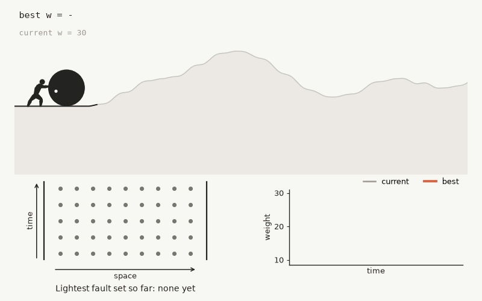

# Sisyphus: a fast circuit-level distance estimator for quantum codes

[](https://unitary.foundation)

Sisyphus estimates the circuit-level distance of quantum error-correction circuits and the
distance of CSS codes. Given a noisy syndrome-extraction circuit as a detector error model
(DEM), it finds small sets of faults that flip a logical observable without triggering any
detector; given a CSS code, it finds low-weight logical operators. The lightest solution
found is an upper bound on the distance, and every bound comes with a witness that can be
checked independently.

<p align="center">
  
</p>

Sisyphus is a **hill-climbing** variant of information-set decoding (ISD). It builds on Prange's
algorithm and its standard refinements, on the quantum distance tools QDistRnd, dist-m4ri and
QDistEvol [[1](#ref-1)–[7](#ref-7)], and on classical metaheuristics. As in other ISD methods, light
codewords are read off a systematic generator matrix, as single rows or as sums of a few rows
found by a collision search, and the search moves between neighbouring information sets by
column swaps. Sisyphus learns where to move: per-column scores, raised by every light
codeword found, decide which columns leave and enter the information set. Searches that stop
improving forget part of what they learned and restart, and many independent searches run in
parallel. The code is Python with [Numba](https://numba.pydata.org/)-compiled, bit-packed
GF(2) kernels.

Sisyphus builds on three existing tools: [QDistRnd](https://github.com/QEC-pages/QDistRnd),
the GAP package that made randomized information-set search practical for quantum codes;
[dist-m4ri](https://github.com/QEC-pages/dist-m4ri), its C successor for codes and
circuit-level models, whose benchmark circuits and DEM reduction we use; and
[QDistEvol](https://github.com/m-webster/codeDistancePYPI), which evolves a population of
information sets instead of drawing them independently. If you use Sisyphus in published
work, please cite it together with QDistRnd and the distance-finding paper of Webster, Jacob
and Higgott (see [Citing](#citing)).

Sisyphus has been incorporated into the Unitary Foundation [QEC Challenge Leaderboard](https://github.com/unitaryfoundation/qldpc-challenge) as a tool
for bounding the circuit-level distance of submissions ([blog post](https://unitary.foundation/posts/2026_qec_challenge/)).

Highlights, from [benchmarks](#benchmarks) against dist-m4ri, QDistEvol and sQetch on the same
problems and hardware:

- **Fastest on the largest instances.** On circuit-level models with 26,000 to 130,000 faults,
  Sisyphus finds lighter fault sets than every other tool within the time limit, in every run:
  weight 16 on the double-gross memory circuit within seconds, 21 on the [[360,12,24]] circuit, 31
  on the 34-round [[756,16,34]] circuit (dist-m4ri: 45–50 after an hour), and the distance 20 of a
  one-round [[4608,2308,20]] circuit, where the other tools stay above 170. It also reaches the
  distance of the largest codes first: [[2844,1426,18]] in 4–17 s, and the Z side of
  [[4608,2308,20]] in a median of 104 s against 276 s.
- **Lighter fault sets than previously reported.** On the [[756,16,34]] and [[360,12,24]] memory
  circuits of the dist-m4ri benchmark set, Sisyphus found fault sets of weight 31 and 21, below
  every value reported before (≤ 56 and ≤ 23). Every witness can be checked with Stim.
- **New syndrome-extraction circuits.** With Sisyphus as a fast filter, we found depth-12 circuits
  for high-rate codes up to [[2304,1156,14]] that keep the code distance as far as long searches
  can tell, where the standard coloration circuits lose up to 8 units of distance in a single
  round ([details](#syndrome-extraction-circuits-found-with-sisyphus)).

On small codes and circuits Sisyphus is competitive and finishes in under a second.

## Contents

1. [Installation](#installation)
2. [Quick start](#quick-start)
3. [Problem](#problem)
4. [Method](#method)
5. [API](#api)
6. [Options](#options)
7. [Benchmarks](#benchmarks)
8. [Syndrome-extraction circuits found with Sisyphus](#syndrome-extraction-circuits-found-with-sisyphus)
9. [Limitations](#limitations)
10. [Repository layout](#repository-layout)
11. [Citing](#citing)
12. [References](#references)
13. [Acknowledgements](#acknowledgements)
14. [Disclosure](#disclosure)
15. [License](#license)

## Installation

From PyPI:

```bash
pip install sisyphus-qec                  # with numpy, numba, scipy and stim
```

From source (also gives the examples, the benchmarks and the `syndrome_extraction` search, which
are not part of the PyPI package):

```bash
git clone https://github.com/varunmenon1310/sisyphus.git
cd sisyphus
pip install -e .
```

The package is imported as `sisyphus_qec`. Python ≥ 3.10. The first call compiles the kernels with Numba (about 30 s); the compiled code
is cached next to the package.

## Quick start

### Distance of a CSS code

```python
from sisyphus_qec import css_distance

# Hx, Hz: binary parity-check matrices (numpy arrays, Hx @ Hz.T = 0 mod 2)
res = css_distance(Hx, Hz, num_trials=200_000, num_workers=8)

res.distance          # min over both sides: an upper bound on the code distance
res.x.distance        # X side (X-type logicals)
res.z.witness         # one Z logical of weight res.z.distance (0/1 vector)
res.z.codewords       # all distinct minimum-weight Z logicals found, one per row
```

Stop at the first logical of a known or target weight with `cutoff`:

```python
res = css_distance(Hx, Hz, num_trials=10_000_000, num_workers=16, cutoff=12)
```

### Circuit-level distance from a Stim circuit

```python
import stim
from sisyphus_qec import dem_to_matrices, side_distance, lift_columns, verify_fault_set

circuit = stim.Circuit.from_file("memory_experiment.stim")
dem = circuit.detector_error_model(decompose_errors=False)
H, L, columns = dem_to_matrices(dem)          # detectors x faults, observables x faults

res = side_distance(H, None, pair_rows=L, num_trials=10_000_000,
                    num_workers=16, time_limit=600)
faults = lift_columns(res.witness, columns)   # indices of errors in dem.flattened()
assert verify_fault_set(dem, faults)          # independent check on the DEM
print("circuit distance <=", res.distance)
```

Complete scripts are in [`examples/`](https://github.com/varunmenon1310/sisyphus/tree/main/examples): `code_distance.py` (gross code,
distance 12) and `circuit_distance.py` (surface-code memory circuit, distance 5).

## Problem

**Code distance.** For a CSS code with check matrices `Hx` and `Hz`, an X-type logical
operator is a binary vector `c` with `Hz c = 0` that is not a sum of rows of `Hx`. The X
distance is the minimum weight of such a vector; the Z distance swaps `Hx` and `Hz`; the code
distance is the smaller of the two.

**Circuit-level distance.** A detector error model [[8](#ref-8)] lists the faults of a noisy
circuit and the detectors and logical observables each fault flips. With one column per fault,
let `H` be the detector matrix and `L` the observable matrix. The circuit-level distance is
the minimum weight of `c` with `H c = 0` and `L c ≠ 0`: the fewest faults that flip an
observable without flipping a detector. It is usually below the code distance, because single
faults such as hook errors on ancilla qubits spread to several data qubits.

Both are instances of one problem: the minimum weight of a vector in the kernel of a binary
matrix outside a given subspace. The problem is NP-hard, and Sisyphus does not prove that no
lighter vector exists.

## Method

### Information-set decoding

Let `G` be a `k × n` generator matrix of the space searched (for X logicals, a basis of
`ker Hz`). Gaussian elimination on a chosen set of `k` columns, the information set, brings `G`
to systematic form, in which those columns form an identity matrix. A codeword with at most one
nonzero entry in the information set is then one of the rows [[1](#ref-1)], and sums of two or
three rows give codewords with two or three entries there [[2](#ref-2)]. Sorting rows by their
values on `ℓ` other columns makes this search efficient [[3](#ref-3)]. Instead of a new
elimination for every trial, the search can move to a neighbouring information set by swapping
one column in and one out [[4](#ref-4)]. It then becomes a random walk over information sets.

### What Sisyphus adds

Each step of a walk swaps 8 columns between the information set and the other columns, chosen
by learned column scores. It then looks for light codewords among single rows and sums of two or
three rows, reduces each one greedily by adding rows while its weight drops, checks that it is a
nontrivial solution, and updates the scores. Every 150 to 2,000 steps, depending on the size of
the problem, the walk restarts from a fresh information set, also chosen by the scores.

**Learning.** Each walk keeps a score for every column. After every step all scores decay by a
small factor, and every row within 2 or 3 of the best weight found so far raises the scores of its
columns, the more the lighter it is. The column that leaves the information set is the
highest-scoring of 8 drawn at random, and the column that enters is the lowest-scoring one the
swap allows. With a small probability a swap is random instead. Columns of light codewords thus
stay outside the information set, where they can be read off, and each light codeword makes
nearby lighter ones easier to find. A search runs three learning walks, with learning rates 1.0,
1.5 and 1.0, decay rates 0.010, 0.006 and 0.010 and random-swap probabilities 0.10, 0.08 and 0.25,
and a fourth walk that swaps at random.

**Escaping local optima.** On its own, a walk would keep finding its best codeword. When its best
weight has not improved for 1,000 steps, and for twice its longest earlier wait between
improvements, the walk resets the scores of a random 30% of that codeword's columns and restarts.

**Column windows.** In block-structured codes, the light logical operators often have most of
their columns in one stretch of the column order. A fifth walk in every search uses this. At each
restart it keeps a random block of consecutive columns, two thirds as many as there are columns
outside the information set, entirely out of the information set, so that only the operator's
other columns need to fall outside by chance. It draws a new block every 50 steps. The random
windows of dist-m4ri [[6](#ref-6)] use the same idea. They make the search about 3 times faster on
the Z side of the [[4608,2308,20]] code and up to 25 times faster on one-round circuits of
affine-permutation and GALA codes. Where they do not help, the extra walk costs a factor of 1.2
to 1.7.

**Parallel searches.** A search is a group of five walks in one worker process, and searches run
independently. Each stops after at most 250,000 steps and is replaced by a freshly seeded one
until the budget `num_trials` is spent. On hard problems the results vary more between searches
than within one, so many moderate searches do better than a few long ones. All searches stop as
soon as one reaches `cutoff`.

**Detector time windows.** The light fault sets of a memory experiment usually span one to three
rounds. For circuits, most searches therefore work on a window of consecutive detectors and keep
only the faults whose detectors all lie in it. A solution of the window problem is also a
solution of the whole circuit. Windows are 10 to 100 times smaller than the full problem and much
easier, because a larger window holds more solutions of the same weight for a walk to get stuck
on. Sisyphus uses windows when the matrix has at least 6 times more columns than rows, as
circuit-level models do.

Sisyphus finds the number of detectors per round as the smallest shift of the detector indices
that leaves the middle of the matrix unchanged. Windows then range from half a round to half the
circuit. For each length there is a window at the start, one at the end, and windows in between
that start at four fixed points of every round (two for windows longer than two rounds), counted
from the boundary between rounds that the fewest faults cross. Windows that differ only by a
shift in time are the same problem and are kept once, so a 24-round circuit gives about 80
distinct problems instead of several hundred. If the rounds do not repeat, Sisyphus uses windows
of a half, a quarter and so on down to 1/32 of the detectors, overlapping by half.

**Adaptive scheduling.** Each distinct window, and the full problem, is a candidate for the next
search. Every candidate first gets one short search, smallest first, which stops after 1,000
steps without improvement. After that, a new search goes to candidate *a* with probability
proportional to

exp(−(w_a − w\*)) / (√(1 + s_a) · t_a),

where w_a is the lightest weight found on the candidate, w\* the lightest weight found overall,
s_a the number of searches on the candidate since its weight last improved, and t_a the average
time of its searches. Candidates with the same weight thus get the same amount of time rather
than the same number of searches. A search on a window runs at most 40,000 steps. At most one
search at a time works on the full problem, and it stops once it has gone 3,000 steps, and as
long as it took to reach its best, without improving. Workers cut each window out of the matrix
when they first need it, which adds only a few seconds to the setup.

**Linear algebra.** Matrices are stored as 64-bit words, and elimination and column swaps use the
Method of Four Russians. Only the part of the systematic form outside the identity is stored, so
work and memory scale with `n − k` instead of `n`. This saves a factor of 4 on rate-1/2 codes and
about 10 on circuit-level models. A fresh information set comes from eliminating the check matrix
in the chosen column order, which is 16 to 35 times cheaper on circuit-level models than reducing
a stored generator matrix.

**Verification.** A vector in the kernel can still be a stabilizer rather than a logical
operator. Every row therefore carries its parities against 64 random vectors that tell the two
apart. For codes these are random elements of the kernel of the other check matrix, and for
circuits random combinations of the observables. A nonzero parity proves that a vector is a
logical operator, so Sisyphus never reports a stabilizer. A logical operator is missed with
probability 2⁻⁶⁴.

## API

```python
from sisyphus_qec import css_distance, side_distance
from sisyphus_qec import dem_to_matrices, lift_columns, verify_fault_set
```

### `css_distance(Hx, Hz, num_trials=20000, num_workers=1, seed=None, cutoff=0, basis="both", ...)`

Distance of the CSS code with X checks `Hx` and Z checks `Hz`. Searches Z
logicals (kernel of `Hx` outside the row space of `Hz`) first, then X logicals.
`basis="z"` or `"x"` searches one side only. With `cutoff > 0` the X side is
skipped when the Z side already reached the cutoff. `num_trials` applies per
side. Returns a `CssDistanceResult` with fields `x` and `z` (each a
`SideResult`) and `distance` (the minimum over the sides searched).

### `side_distance(check_H, dual_H, num_trials=20000, num_workers=1, seed=None, cutoff=0, pair_rows=None, ...)`

Lightest vector `c` with `check_H c = 0` outside the row space of `dual_H`. For
X logicals of a CSS code call `side_distance(Hz, Hx)`, for Z logicals
`side_distance(Hx, Hz)`. For a detector error model call
`side_distance(H, None, pair_rows=L)`: `pair_rows` is any set of vectors such
that `c` is nontrivial exactly when it has odd overlap with one of them (for a
DEM, the observable matrix).

### `SideResult`

- `distance`: weight of the lightest verified solution found (an upper bound); `-1` if the side was skipped
- `witness`: one solution of that weight (uint8 vector)
- `codewords`: all distinct solutions of that weight found (one per row; capped by `max_codewords` per search)
- `counts`: how many times each of them was found
- `num_codewords`: number of rows of `codewords`
- `shots`: steps performed (all walks)
- `wall_time`: seconds
- `islands`: number of independent searches run
- `t_best`: estimated time (s) at which `distance` was first reached
- `arms`: adaptive scheduler: one entry per candidate problem (name, rows, searches, steps, time, lightest weight)
- `history`: adaptive scheduler: (time, weight, steps, candidate) at each improvement of the lightest weight, estimated from the round in which the search reached it

### DEM helpers (`sisyphus_qec.dem`)

- `dem_to_matrices(dem, merge_duplicates=True)` → `(H, L, columns)`. One
  column per fault of a `stim.DetectorErrorModel`. Faults with identical effects
  are merged; `columns[j]` lists the DEM error indices behind column `j`.
- `lift_columns(codeword, columns)` maps a solution over the columns to DEM
  error indices (positions among the error instructions of `dem.flattened()`).
- `verify_fault_set(dem, error_indices)` is an independent check on the DEM:
  the faults are distinct, flip no detector, and flip at least one observable.

Matrices are passed as dense 0/1 numpy arrays and bit-packed internally.

## Options

> **The defaults work well across codes of very different sizes and across
> circuit-level instances, and we do not recommend changing them.** They were
> chosen by equal-wall-clock comparisons on small, medium and large codes and on
> circuit-level models, and every default is the best setting found in those
> comparisons. The search parameters interact in ways that are hard to tune by
> hand. If you need to tune them for a specific family of instances, use an
> automated hyperparameter search (for example an agentic optimization loop that
> scores settings by time-to-target over several seeds), not one-off manual
> changes.

The options you normally set are the **run options**. The **search parameters**
can be passed as keyword arguments to `css_distance` and `side_distance`; they
are listed for completeness.

### Run options

- `num_trials` (default `20000`): total number of steps over all searches (per side for `css_distance`). One step = one move of one walk plus the search for light codewords. The column-window walk runs on top of this budget (5 steps per 4 counted).
- `num_workers` (default `1`): searches run in parallel (one process each). `None` = all available CPU cores. `1` runs in the calling process.
- `cutoff` (default `0`): stop as soon as a solution of weight `≤ cutoff` is found. `0` runs the whole budget, which also collects the set of minimum-weight solutions.
- `time_limit` (default `None`): wall-clock budget in seconds (`side_distance`). The search returns the best result so far when it expires. Works for any `num_workers`, including `1`.
- `seed` (default `None`): random seed (`None` = fresh randomness).
- `island_shots` (default `None`): step budget of one search before it is replaced by a fresh one. `None` = an equal share of `num_trials` per worker, capped at 250,000.
- `walkers_per_island` (default `4`): random walks per search: three learning walks with different settings and one non-learning walk, plus the column-window walk when `col_window` ≠ 0. Larger values reuse these settings in turn.
- `num_seeds` (default `None`): older alternative to `island_shots`: split the budget into this many waves of `num_workers` searches.
- `pair_rows` (default `None`): vectors defining nontriviality (see `side_distance`). Required for detector error models (`L`).
- `collect_codewords` (default `True`): keep the set of minimum-weight solutions (otherwise one).
- `basis` (default `"both"`): `css_distance` only: `"both"`, `"z"` or `"x"`.
- `compact` (default `None`): `None` / `True`: compact `[I

### Search parameters

- `swaps_per_shot` (default `8`): column swaps per step, applied as one batch.
- `restart_interval` (default `None`): steps between fresh information sets. `None` = `min(2000, max(150, k/3))` with `k` the dimension of the searched space.
- `lb_p` (default `2`): sums of rows examined: `0` single rows only, `1` + pairs, `2` + triples.
- `lb_hash_l` (default `12`): `ℓ`, the number of random redundant columns used to bucket rows in the collision search [[3](#ref-3)]. `0` = exhaustive pairs and triples among the lightest rows instead.
- `lb_M` (default `256`): size of the list of lightest rows used for triples. Use `48` with `lb_hash_l=0`.
- `lb_R` (default `48`): rows used as the first element of a triple.
- `lb_hash_windows` (default `1`): independent random column sets for bucketing per step.
- `greedy_passes` (default `4`): sweeps of greedy weight reduction per codeword found (`0` = off).
- `kick_rounds` (default `1000`): a learning walk whose best weight has not improved for this many steps partially forgets and starts over (`0` = off).
- `kick_frac` (default `0.3`): fraction of the best codeword's columns whose score is reset when starting over.
- `kick_patience` (default `2.0`): also wait at least this multiple of the walk's longest gap between improvements so far.
- `restart_from_h` (default `1`): compute fresh information sets by eliminating the check matrix (cheaper; identical result).
- `windows` (default `"auto"`): detector time windows: `"auto"` = on when columns ≥ 6× rows (circuit models), otherwise off; `0` = off.
- `scheduler` (default `"adaptive"`): `"adaptive"`: searches are assigned to windows by their results (see Method). `"static"`: a fraction `window_frac` of the searches runs on windows drawn at random.
- `period_windows` (default `1`): use windows aligned to the rounds of the circuit when a period is found (`0` = halving windows only).
- `arm_tau` (default `1.0`): weight scale of the adaptive scheduler.
- `arm_cost_power` (default `1.0`): exponent of the mean search time in the adaptive scheduler (`0` = equal numbers of searches).
- `full_stall_stop` (default `3000`): a search on the full problem stops after this many steps without improvement (and at least as long as it took to reach its best).
- `window_island_max` (default `40000`): most steps of one window search.
- `first_pass_stall` (default `1000`): the first search of each window stops after this many steps without improvement (`0` = full budget).
- `return_codewords` (default `256`): adaptive scheduling: a search sends back at most this many solutions, and none if it did not reach the lightest weight known when it started (`0` = no limit).
- `window_frac` (default `0.5`): `scheduler="static"`: fraction of searches that run on a window.
- `window_rounds` (default `5000`): steps a window search spends on one window before moving to another.
- `window_min` (default `16`): smallest window, in detectors.
- `explorer_restart` (default `0`): how often the non-learning walk starts over (`0` = same as the others). `1` draws a fresh uniform information set every step.
- `col_window` (default `0.67`): size of the column window: a fraction of the number of redundant columns (`0 < col_window < 1`), a number of columns (`≥ 1`), or `-1` for a random fraction in [0.33, 0.78] per window. `0` = off.
- `col_window_rounds` (default `50`): steps the column-window walk spends on one window before drawing a new one.
- `col_window_extra` (default `1`): `1`: the column-window walk is an extra (fifth) walk. `0`: it replaces the non-learning walk (faster on some codes, but about 3× slower on the X side of [[4608,2308,20]]).
- `max_codewords` (default `2000`): minimum-weight solutions stored per search.
- `m4ri_k` (default `8`): block size of the Method of Four Russians in elimination.
- `proj_words` (default `1`): 64-bit words of random parities used for verification (64 parities per word).
- `migrate_interval`, `migrate_boost` (default `100`, `0.0`): sharing of the best codeword between the walks of a search (off by default: it made the walks converge on one codeword).
- `stall_rounds` (default `0`): restart a whole search after this many steps without improvement (off).
- `greedy_kicks`, `kick_size`, `mix_rate`, `lb_hash_p4` (default `0`, `2`, `0.0`, `0`): experimental; not used by the default compact search.

## Benchmarks

We compare Sisyphus with three other methods that search for low-weight logical operators and
fault sets, all of which give upper bounds:

- [dist-m4ri](https://github.com/QEC-pages/dist-m4ri) [[6](#ref-6)], a C program for codes and
  circuit-level models. Its upper-bound search draws random information sets restricted to
  random windows of columns; a separate connected-cluster mode proves lower bounds.
- QDistEvol [[7](#ref-7)], part of the Python `codedistance` package, which evolves a population
  of information sets: the best ones of each generation are mutated by random column swaps.
- [sQetch](https://github.com/a7b/yarn/tree/main/sqetch) [[12](#ref-12)], a GPU estimator
  introduced with the Mitten codes. It runs many independent information-set trials in parallel,
  each on a random low-dimensional sketch of one fixed basis of the searched space.

A recent survey and benchmark of distance-finding methods [[7](#ref-7)] describes dist-m4ri and
QDistEvol in more detail. Setup:

- The CPU tools each get 16 cores of one Intel Xeon 8480 node: 16 worker processes for
  Sisyphus, 16 threads for dist-m4ri (v0.14.7, random information sets, default settings), and
  16 independent runs for QDistEvol (`codedistance` v0.0.8, default settings), timed to the
  first run that reaches the target. sQetch runs only on GPUs and gets one NVIDIA A100 (sketch
  dimension 64, or the largest that fits).
- Each run stops at the target weight, which is the exact distance where known and otherwise
  the lightest known weight. Each tool has three runs per problem. Times exclude loading and
  compilation. All solutions were verified.
- Circuits are memory experiments from the dist-m4ri benchmark set [[6](#ref-6)] (SI1000-noise
  circuits distributed with the Tesseract decoder [[13](#ref-13)]) or single noisy rounds of
  syndrome extraction; sizes are detectors × faults after exact reduction to one basis.
- Bold marks the best result in each row.

### Largest instances: lighter fault sets, sooner

On circuit-level models with tens of thousands of faults or more, Sisyphus finds lighter fault
sets than every other tool, in every run, within seconds to minutes. The table gives the lightest
weight each tool found within the time limit (30 minutes for the first two circuits, 1 hour for
the others; 3 runs per tool) and the fastest time in which Sisyphus reached its weight. "OOM": the
16 parallel QDistEvol runs need more than the 180 GB of the node; "too large": one sketch row of
sQetch exceeds the GPU's shared memory. sQetch's codeword recovery did not return a valid word for
its weight 39 on the [[360,12,24]] circuit.

| circuit | rounds | faults | Sisyphus | time | dist-m4ri | QDistEvol | sQetch |
|---|---|---|---|---|---|---|---|
| double&nbsp;gross&nbsp;[[288,12,18]] | 18 | 26,208 | **16** | 0.3&nbsp;s | 18 | 31 | 23 |
| [[360,12,24]] | 24 | 43,560 | **21** | 0.7&nbsp;s | 22 | 63 | 39 |
| [[756,16,34]] | 34 | 129,276 | **31** | 1&nbsp;s | 45 | OOM | too&nbsp;large |
| [[4608,2308,20]] | 1 | 29,952 | **20** | 335&nbsp;s | 490 | 574 | 174 |

Sisyphus reaches weight 20 on the one-round [[4608,2308,20]] circuit in every run. On the
[[756,16,34]] circuit, dist-m4ri stayed between 45 and 50 after an hour.

The same holds for the largest codes. The table gives the fastest time to reach the code distance
(limits: 10 minutes for [[2844,1426,18]] and [[756,16,34]], 1 hour for [[4608,2308,20]]; 3 runs
per tool, 6 for Sisyphus on [[4608,2308,20]]); ✗&nbsp;(w) means that no run reached it and w is the
lightest weight found. The median times on [[4608,2308,20]] favour Sisyphus on both sides: 104&nbsp;s
against 276&nbsp;s on Z and 1,452&nbsp;s against 1,641&nbsp;s on X.

| code | d | Sisyphus | dist-m4ri | QDistEvol | sQetch |
|---|---|---|---|---|---|
| [[2844,1426,18]]&nbsp;Cornucopia&nbsp;[[10](#ref-10)] | 18 | **4&nbsp;s** | 14&nbsp;s | ✗&nbsp;(24) | ✗&nbsp;(22) |
| [[4608,2308,20]]&nbsp;Z&nbsp;[[11](#ref-11)] | 20 | **33&nbsp;s** | 125&nbsp;s | ✗&nbsp;(192) | ✗&nbsp;(128) |
| [[4608,2308,20]]&nbsp;X | 20 | 382&nbsp;s | **86&nbsp;s** | ✗&nbsp;(212) | ✗&nbsp;(22) |
| [[756,16,34]]&nbsp;[[9](#ref-9)] | 34 | **0.07&nbsp;s** | 0.1&nbsp;s | 2.4&nbsp;s | 80&nbsp;s |

### Fault sets lighter than previously reported

Sisyphus found lighter fault sets than any reported before on circuits of the dist-m4ri benchmark
set [[6](#ref-6)]: SI1000-noise memory circuits distributed with the Tesseract decoder
[[13](#ref-13)] and uniform-noise memory circuits distributed with Relay-BP [[14](#ref-14)].
Previous values are from the table of circuit-level distances in the dist-m4ri benchmark
documentation [[6](#ref-6)] and from the published results data of the benchmark of
distance-finding methods [[7](#ref-7)], which used the same circuits. No bound was reported for the
X basis of the [[756,16,34]] circuit; the best for its Z basis was 56.

Sisyphus is also used by the Unitary Foundation [QEC Challenge Leaderboard](https://github.com/unitaryfoundation/qldpc-challenge) to bound the circuit-level distance of
submissions ([blog post](https://unitary.foundation/posts/2026_qec_challenge/)). On several codes of the leaderboard it has found lower distances than previously reported. The first
examples are in the [evidence table](https://github.com/unitaryfoundation/qldpc-challenge/pull/7264#evidence) of the pull request that adds Sisyphus to the leaderboard's
circuit-distance check (under review). On seven entries with circuit models of 119,000 to 135,000
faults, Sisyphus found undetected logical fault sets of weight 9 to 16 against claimed circuit
distances of 16 to 19, each confirmed by the leaderboard's own checker. These results will be added
to the table below once they are compiled.

| circuit&nbsp;(dist-m4ri&nbsp;benchmark) | basis | previously&nbsp;reported | Sisyphus |
|---|---|---|---|
| `bb_756_16_34_si1000_r34` | X | none | **31** |
| `bb_360_12_24_si1000_r24` | X | 23&nbsp;[[6](#ref-6)] | **21** |
| `bb_360_12_24_si1000_r24` | Z | 88&nbsp;[[7](#ref-7)] | **21** |

Each witness in [`benchmarks/witnesses/`](https://github.com/varunmenon1310/sisyphus/tree/main/benchmarks/witnesses) lists its faults (the detectors
and observables each one flips) and can be checked against the original circuits with Stim:

```bash
python benchmarks/verify_witnesses.py /path/to/dist-m4ri/benchmark
```

### Small instances

On codes up to a few thousand qubits and circuits with fewer than 10⁴ faults, the tools that reach
the target take about a second or less, and dist-m4ri is usually first because its start-up cost
is lower. The table gives the fastest of 3 runs (limit 10 minutes); ✗&nbsp;(w) as above.

| problem | target | Sisyphus | dist-m4ri | QDistEvol | sQetch |
|---|---|---|---|---|---|
| gross&nbsp;[[144,12,12]] | 12 | 0.03&nbsp;s | **<&nbsp;0.01&nbsp;s** | **<&nbsp;0.01&nbsp;s** | 0.01&nbsp;s |
| [[1152,580,12]] | 12 | 0.05&nbsp;s | **0.01&nbsp;s** | 0.4&nbsp;s | 0.09&nbsp;s |
| [[2304,1156,14]] | 14 | 0.1&nbsp;s | **0.04&nbsp;s** | 18&nbsp;s | 2.6&nbsp;s |
| gross&nbsp;circuit,&nbsp;12&nbsp;rounds | 10 | 0.16&nbsp;s | **0.03&nbsp;s** | 89&nbsp;s | ✗&nbsp;(11) |
| Mitten&nbsp;[[270,54,10]]&nbsp;circuit | 9 | 0.3&nbsp;s | **0.04&nbsp;s** | 487&nbsp;s | ✗&nbsp;(10) |

### Large interleaved memory circuits

Sisyphus finds the number of detectors per round, searches windows of whole and partial rounds,
and gives more time to the windows that have produced the lightest fault sets (see
[What Sisyphus adds](#what-sisyphus-adds)). On memory circuits of 14 to 34 rounds with up to
180,000 faults (interleaved circuits of the affine-permutation, GALA and Mitten codes, and the
[[756,16,34]] circuit) and on single rounds of syndrome extraction, it reaches the lightest known
weight within seconds to minutes. The tables give the fastest of 3 runs with 16 worker processes on
one Intel Xeon 8480 node, as search time excluding setup (20 to 65&nbsp;s), with limits of 30 minutes
for the memory circuits and 1 hour for the single rounds; ✗&nbsp;(w) means that no run reached the
target. On one more Mitten circuit, Sisyphus found a fault set of weight 22, below the lightest
weight known before (23).

**Memory circuits: time to the lightest known weight**

| circuit | rounds | target | time |
|---|---|---|---|
| [[630,126,20]]&nbsp;Mitten | 20 | 19 | 79&nbsp;s |
| [[780,156,22]]&nbsp;Mitten | 22 | 21 | 4&nbsp;s |
| [[975,195,24]]&nbsp;Mitten | 24 | 22 | 10&nbsp;s |
| [[975,195,24]]&nbsp;Mitten,&nbsp;2nd&nbsp;circuit | 24 | 20 | 0.1&nbsp;s |
| [[975,195,24]]&nbsp;Mitten,&nbsp;3rd&nbsp;circuit | 24 | 23 | 2&nbsp;s |
| [[2304,1156,14]]&nbsp;affine-permutation | 14 | 11 | 133&nbsp;s |
| [[1752,880,14]]&nbsp;GALA | 14 | 11 | 2&nbsp;s |
| [[756,16,34]]&nbsp;bivariate&nbsp;bicycle | 34 | 31 | 1&nbsp;s |

**Single rounds of syndrome extraction: time to the lightest known weight**

| circuit | target | time |
|---|---|---|
| [[4608,2308,20]]&nbsp;affine-permutation,&nbsp;X | 20 | 335&nbsp;s |
| [[4608,2308,20]]&nbsp;affine-permutation,&nbsp;Z | 20 | 182&nbsp;s |
| [[2232,1120,16]]&nbsp;GALA,&nbsp;X | 14 | 277&nbsp;s |
| [[2232,1120,16]]&nbsp;GALA,&nbsp;Z | 13 | ✗&nbsp;(14) |

A fault set of weight 13 is known on the Z side of the GALA single round, but none of the three
runs reached it within the hour.

We also searched again 19 interleaved circuits for which earlier searches of 30 to 60 minutes on
the d-round circuit had found no fault set lighter than d, for 20 minutes each, stopping at the
first fault set of weight d − 1. Sisyphus found one for 8 of the 19 circuits.

## Syndrome-extraction circuits found with Sisyphus

Coloration circuits, the standard syndrome-extraction circuits of high-rate qLDPC codes, take 24
layers and already lose distance in one round. Using Sisyphus to reject bad candidates within
seconds, we found depth-12 interleaved circuits that keep the code distance as far as long
searches can tell (strong evidence, not a proof):

| code | d | coloration&nbsp;circuit,&nbsp;one&nbsp;round | interleaved&nbsp;circuit,&nbsp;depth&nbsp;12 |
|---|---|---|---|
| [[2304,1156,14]]&nbsp;affine-permutation&nbsp;[[11](#ref-11),&nbsp;[15](#ref-15)] | 14 | 13 | **14** |
| [[2232,1120,16]]&nbsp;GALA&nbsp;[[16](#ref-16)] | 16 | 13 | **16** |
| [[1752,880,14]]&nbsp;GALA&nbsp;[[16](#ref-16)] | 14 | 13 | **14** |
| [[975,195,24]]&nbsp;Mitten&nbsp;[[12](#ref-12)] | 24 | 17 | **24** |
| [[630,126,20]]&nbsp;Mitten&nbsp;[[12](#ref-12)] | 20 | 12 | **20** |

The circuits are in
[`syndrome_extraction/schedules/circuits.json`](https://github.com/varunmenon1310/sisyphus/blob/main/syndrome_extraction/schedules/circuits.json);
the paper's circuits, Stim files and hardware data are in
[hardware-efficient-syndrome-extraction](https://github.com/varunmenon1310/hardware-efficient-syndrome-extraction).

## Limitations

- Sisyphus gives upper bounds only. For lower bounds use an exact method, for example the
  connected-cluster search of dist-m4ri.
- Matrices are passed as dense arrays (one byte per entry before packing), which matters above
  about 10⁵ × 10⁵. A reduced circuit model of 13,230 × 129,276 takes about 1.7 GB.
- The first call compiles the kernels (about 30 s); later runs use the cache.

## Repository layout

```
sisyphus/
├── sisyphus_qec/
│   ├── search.py         public entry points (css_distance, side_distance) and the
│   │                     parallel searches (process pool, scheduling, early stop)
│   ├── setup.py          per-side setup: packed check matrix, verification parities,
│   │                     starting basis
│   ├── chain_compact.py  one search (four random walks) on the compact [I | P] form (default)
│   ├── chain_full.py     the same on full-width rows (compact=False)
│   ├── extraction.py     light codewords from rows and sums of rows (collision search)
│   │                     and greedy weight reduction
│   ├── windows.py        detector time windows for circuit-level models
│   ├── gf2.py            bit-packed GF(2) linear algebra (Four-Russians row reduction)
│   ├── params.py         default search parameters
│   ├── results.py        result types
│   └── dem.py            Stim detector error model helpers
├── examples/             code_distance.py, circuit_distance.py, codes.py
├── tests/                pytest suite (known distances, brute force on random codes,
│                         a circuit)
├── syndrome_extraction/  search for distance-preserving syndrome-extraction circuits,
│                         and the best circuits found
└── benchmarks/
    ├── witnesses/        fault sets behind the circuit-level bounds
    └── verify_witnesses.py
```

Run the tests with `python -m pytest tests/`.

## Citing

Please cite Sisyphus, the QDistRnd paper and the distance-finding paper of Webster, Jacob and
Higgott:

```bibtex
@software{sisyphus,
  title   = {{Sisyphus}: a fast circuit-level distance estimator for quantum codes},
  author  = {Menon, Varun},
  year    = {2026},
  url     = {https://github.com/varunmenon1310/sisyphus}
}

@article{qdistrnd,
  title   = {{QDistRnd}: A {GAP} package for computing the distance of quantum
             error-correcting codes},
  author  = {Pryadko, Leonid P. and Shabashov, Vadim A. and Kozin, Valerii K.},
  journal = {Journal of Open Source Software},
  volume  = {7},
  number  = {71},
  pages   = {4120},
  year    = {2022},
  doi     = {10.21105/joss.04120}
}

@article{webster2026distance,
  title   = {Distance-Finding Algorithms for Quantum Codes and Circuits},
  author  = {Webster, Mark and Jacob, Abraham and Higgott, Oscar},
  journal = {arXiv preprint arXiv:2603.22532},
  year    = {2026}
}
```

## References

Information-set decoding and low-weight codeword search:

1. <a id="ref-1"></a>E. Prange, "The use of information sets in decoding cyclic codes", *IRE
   Transactions on Information Theory* 8(5), 5–9 (1962). Information sets;
   reading codewords off a systematic generator matrix.
2. <a id="ref-2"></a>P. J. Lee and E. F. Brickell, "An observation on the security of McEliece's
   public-key cryptosystem", *EUROCRYPT 1988*, LNCS 330, 275–280 (1988). Sums of
   several rows.
3. <a id="ref-3"></a>J. Stern, "A method for finding codewords of small weight", *Coding Theory and
   Applications* (Toulon, 1988), LNCS 388, 106–113, Springer (1989). Collision search on a subset of
   redundant columns.
4. <a id="ref-4"></a>A. Canteaut and F. Chabaud, "A new algorithm for finding minimum-weight words
   in a linear code: application to McEliece's cryptosystem and to narrow-sense
   BCH codes of length 511", *IEEE Transactions on Information Theory* 44(1),
   367–378 (1998). Moving between information sets by single column swaps.

Distance of quantum codes and circuits:

5. <a id="ref-5"></a>L. P. Pryadko, V. A. Shabashov and V. K. Kozin, "QDistRnd: A GAP package for
   computing the distance of quantum error-correcting codes", *Journal of Open
   Source Software* 7(71), 4120 (2022).
6. <a id="ref-6"></a>L. P. Pryadko and Weilei Zeng, dist-m4ri: distance of a classical or quantum CSS
   code, https://github.com/QEC-pages/dist-m4ri (v0.14.7). Random-window information sets and
   connected-cluster search for codes and detector error models; the circuit-level benchmark
   set used here and its table of circuit-level distances (section 2.4 of
   https://github.com/QEC-pages/dist-m4ri/blob/master/benchmark/BENCHMARK.md). The connected-cluster method: I. Dumer, A. A. Kovalev and L. P. Pryadko,
   "Distance verification for classical and quantum LDPC codes", *IEEE Transactions on
   Information Theory* 63(7), 4675–4686 (2017).
7. <a id="ref-7"></a>M. Webster, A. Jacob and O. Higgott, "Distance-Finding Algorithms for Quantum
   Codes and Circuits", arXiv:2603.22532 (2026). QDistEvol and the `codedistance` package,
   https://github.com/m-webster/codeDistancePYPI.
8. <a id="ref-8"></a>C. Gidney, "Stim: a fast stabilizer circuit simulator", *Quantum* 5, 497
   (2021). Detector error models.

Codes used in the benchmarks:

9. <a id="ref-9"></a>S. Bravyi, A. W. Cross, J. M. Gambetta, D. Maslov, P. Rall and T. J. Yoder,
    "High-threshold and low-overhead fault-tolerant quantum memory", *Nature*
    627, 778–782 (2024). Bivariate bicycle codes.
10. <a id="ref-10"></a>Z. Lu, W. Li and D.-L. Deng, "Quantum error correction at ultra-low
    overhead", arXiv:2608.02773 (2026). Cornucopia codes; check matrices at
    https://github.com/ZhideLu/Cornucopia_code.
11. <a id="ref-11"></a>C. Zhao, C. Duckering, A. Gu, N. Maskara and H. Zhou, "Towards ultra-high-rate
    quantum error correction with reconfigurable atom arrays", arXiv:2604.16209 (2026).
    Affine-permutation codes.
12. <a id="ref-12"></a>A. Bhardwaj, M. Ma, N. Meister, R. King, D. Bluvstein, J. Preskill, M. Cain,
    Q. Xu and H.-Y. Huang, "High-rate qLDPC processors", arXiv:2607.28795 (2026). Mitten codes
    and the sQetch distance estimator.

Circuits used in the benchmarks:

13. <a id="ref-13"></a>L. Aghababaie Beni, O. Higgott and N. Shutty, "Tesseract: A search-based
    decoder for quantum error correction", arXiv:2503.10988 (2025). SI1000-noise memory circuits
    of bivariate bicycle codes, https://github.com/quantumlib/tesseract-decoder.
14. <a id="ref-14"></a>T. Müller, T. Alexander, M. E. Beverland, M. Bühler, B. R. Johnson,
    T. Maurer and D. Vandeth, "Improved belief propagation is sufficient for real-time decoding
    of quantum memory", arXiv:2506.01779 (2025). Uniform-noise memory circuits of bivariate
    bicycle codes, https://github.com/trmue/relay.

Codes of the syndrome-extraction search:

15. <a id="ref-15"></a>K. Kasai, "Breaking the orthogonality barrier in quantum LDPC codes",
    *Quantum* 10, 2205 (2026), arXiv:2601.08824. Affine-permutation codes.
16. <a id="ref-16"></a>W. Yang, C. Duckering and A. Dua, "Designer codes from GALA: compact,
    self-dual, and rate-1/2 QEC on reconfigurable atom arrays", arXiv:2608.07431 (2026).

## Acknowledgements

The author gratefully acknowledges support from the Unitary Foundation and the Anthropic AI for
Science program. This algorithm was developed in part using various models from the Claude family.
We thank Nishad Maskara, Oscar Higgott, Tomas Jochym-O'Connor, Andi Gu, Nazli Ugur Koyluoglu, Rohan
Mehta, and Farrokh Labib for valuable discussions. The author would particularly like to thank Nazli Ugur
Koyluoglu for suggesting the name Sisyphus.

## Disclosure

Part of this package was developed while the author was an employee at Google
Research.

## License

Sisyphus is released under the Apache License 2.0 (see [LICENSE](https://github.com/varunmenon1310/sisyphus/blob/main/LICENSE)).
